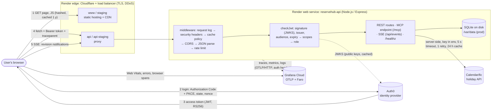
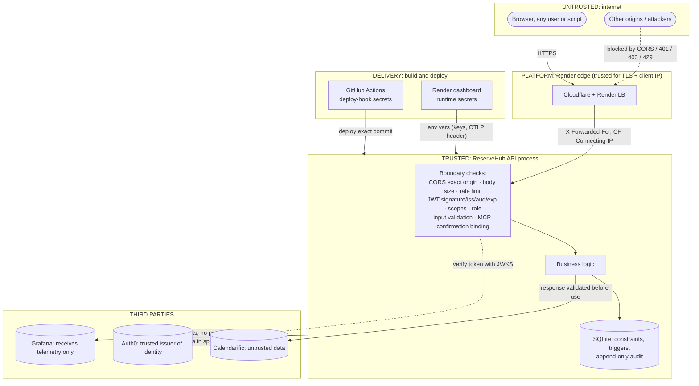

# Architecture: request path and trust boundaries (Q2)

GitHub renders these Mermaid diagrams when the file is viewed in the repository.

## 1. Request path

Step by step for "make a reservation":

1. The browser loads the static site from `www.reservehub-hh.com`.
2. "Log in" redirects to Auth0 (Authorization Code + PKCE, with `state` and
   `nonce`); Auth0 redirects back with a code, and the SDK exchanges it for an
   access token for audience `https://reservehub-api`.
3. The form calls `POST https://api.reservehub-hh.com/api/reservations` with
   `Authorization: Bearer <token>` and a `traceparent` header.
4. Render's edge terminates TLS and forwards to the API.
5. The API: logs the request, adds security headers, checks CORS (exact origin),
   parses JSON (16 KB limit), applies the write rate limit (keyed by
   `CF-Connecting-IP`), validates the JWT, checks `write:reservations` and the
   `scheduler` role, validates the body, then inserts the reservation and its
   audit event in one SQLite transaction (database triggers reject overlaps
   and closures).
6. Other open pages learn about the change through the SSE stream and refetch.
7. Spans from the browser and the API share one trace in Grafana.

MCP path: the MCP panel calls `POST /mcp` (tools) and `POST /mcp/confirmations`
(preview). Each tool checks its own scope; `create_reservation` needs a
single-use, user-bound, 5-minute confirmation ID and then calls the REST route
above over loopback, so the same validation and audit apply.

## Live updates: why SSE (F11)

**What the app needs:** when anyone books, edits, cancels, or closes a room,
every open page should refresh its room list and schedule. The data flows one
way, server to browser. Browsers never send anything over this channel; all
changes go through the normal authenticated REST API.

**Why Server-Sent Events fit better than WebSockets here:**

- **One-way is all we need.** SSE is a plain HTTP response that stays open and
  carries server-to-browser messages. WebSockets add a two-way protocol we would
  not use.
- **Automatic reconnection is built in.** The browser's `EventSource`
  reconnects by itself (the server sets `retry: 3000`), so no reconnect code is
  needed on the client.
- **It works through the existing HTTP stack.** Same CORS rules, same Render
  proxy, same HTTPS. No protocol upgrade, which some proxies handle poorly.
- **No secrets travel over it.** The stream is public and carries only an
  opaque revision string (`"12-3"`), never reservation details or identities,
  so it needs no authentication of its own.

**Recovery after a disconnect (documented snapshot recovery):**

1. Revisions come from the append-only audit tables:
   `MAX(audit_events.id)` and `MAX(closure_audit.id)`, so they are persisted
   in the database and survive restarts.
2. Every message has an event ID (`id: <revision>`).
3. On every new or re-established connection, the server immediately sends the
   current revision. The client treats that as "refetch everything" (snapshot),
   so anything missed while disconnected is recovered by reloading the current
   state rather than replaying individual events.
4. **Client deduplication:** the client ignores a message whose revision equals
   the last one it processed, and resets that memory on reconnect so the
   snapshot is always applied (`src/useLiveUpdates.tsx`).

**Trade-off:** snapshot recovery refetches whole lists instead of replaying
deltas. For a building with a handful of rooms the lists are tiny, so this is
simpler and cannot drift out of sync. At 100× traffic, change detection should
move to one shared poller (see `docs/cost.md`).

## 2. Trust boundaries

| Boundary | What crosses it | What we trust | How it is enforced |
|---|---|---|---|
| Internet → Render edge | All traffic | Nothing from the client | HTTPS only (HSTS), Render DDoS protection |
| Edge → API | Requests + forwarding headers | `CF-Connecting-IP` (set by Cloudflare, client copies overwritten; API not reachable except via the edge) | `server/client-ip.cjs`; ignored when not on Render |
| Client data → business logic | Headers, JSON bodies, query strings, tokens | Only verified JWT claims | `checkJwt` (signature, issuer, audience, expiry), scope + role checks, `validation.cjs`, 16 KB body limit |
| Browser origin → API | Cross-origin requests | Exactly one origin per environment | CORS `FRONTEND_ORIGIN`; MCP also rejects other `Origin`s |
| API → Calendarific | Outgoing request with key in URL | Nothing in the response | Runtime validation of every field, year check, 5 s timeout, bounded retry, key never logged |
| API → Grafana | Telemetry | n/a (outbound only) | No tokens or request bodies in spans or logs; auth header from env |
| Delivery → runtime | Code + configuration | GitHub repo `main`, Render secrets | Tests + staging gate before production; secrets only in Render/GitHub, `.env` and databases git-ignored |
| Database | Writes | Only the API process | Constraints, overlap/closure triggers, append-only audit triggers |
